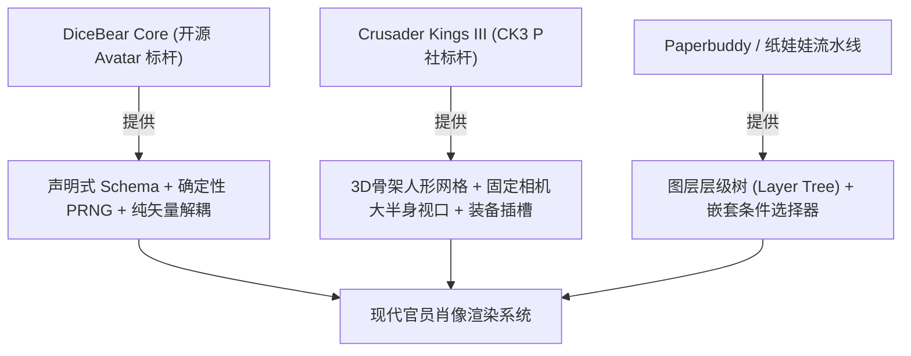
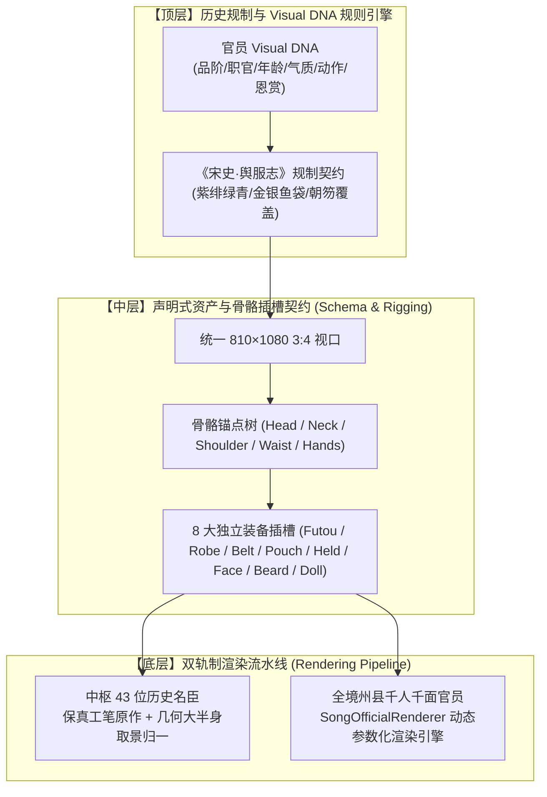

# 《北宋官员肖像与装备渲染系统》技术设计稿（System Design Document）

> **项目名称**：《宋祚》（Songzuo）职官立绘与动态换装子系统  
> **文档版本**：v2.0.0-PROD  
> **权威裁定**：[JEV-台账-北宋官员肖像与装备渲染系统权威架构设计稿-2026-10-16.json](file:///d:/codebuddy/sz/_dev_tools/handover/decisions/JEV-台账-北宋官员肖像与装备渲染系统权威架构设计稿-2026-10-16.json)（$p=0.9828$）  
> **核心宗旨**：彻底废黜“静态位图切片硬拼”的粗暴旧法，全面确立“**参数化动态渲染（Render Engine）**”与“**严格统一大半身像（Three-Quarter Bust）固定视口**”的现代工业化换装体系。

---

## 一、 执行摘要与问题复盘（Executive Summary）

### 1.1 历史弯路深刻复盘
在早期的尝试中，系统曾试图采用“自动化横向切刀+Alpha半透明渐变（`_headcut.py`）”或“从位图上截取矩形图块进行 PIL 拼合”，导致了灾难性的视觉崩坏：
1. **断头白洞与颈项脱节**：强行切除头部或身躯，导致下巴与领口之间出现大片空白背景，人物宛如被腰斩或枭首；
2. **浮空几何方块**：用简单像素图层叠加，腰带脱离人体腰线浮空在胸口，帽子浮于头颅半空；
3. **比例与景别严重失调**：由于古代各画师取景距离不一，蔡京等画作只画到胸部（特写大头），而边防将领画到了脚踝（全身缩略图），混排在一起时忽大忽小，视觉违和感极其强烈。

### 1.2 核心指导思想
用户明确指出：
> **“RPG游戏的人物是怎么区分的，不就是原始人物图加一件件装备，现在只是还有区分脸而已”**  
> **“怎么又切脸了，多生成点布娃娃不就好了”**  
> **“展示比例要一致啊，怎么有的半身有的全身”**  
> **“难道不应该是渲染的吗”**

本设计稿正式宣告：**在《宋祚》中，布娃娃换装系统是一个由参数驱动的“渲染引擎（Render Engine）”，而不是位图贴图拼凑器！**

---

## 二、 行业开源标杆深度解构（State-of-the-Art Research）

通过对 GitHub 及现代游戏工业顶尖项目的系统性调研，本系统确立了对三大标杆项目的架构借鉴：



### 2.1 标杆一：[dicebear/dicebear](https://github.com/dicebear/dicebear)（声明式矢量参数化渲染）
- **核心机制**：
  - 样式与引擎彻底解耦：样式完全由声明式的 **JSON Schema** 描述，没有任何硬编码图片；
  - **确定性管线（Deterministic Pipeline）**：输入字符串种子（`seed`），通过 **FNV-1a** 哈希算法初始化 **Mulberry32 PRNG**，派生出确定性的组件选择与配色；
  - **纯矢量组装（Pure SVG Assembly）**：每一个组件（eyes, mouth, clothing, hat）都是在统一定义的 `viewBox` 下的矢量几何路径（SVG Paths），动态拼合输出。
- **借鉴点**：**零切刀、零像素拉伸、零分辨率上限**。无论怎么换装，各部位依靠数学坐标对齐，绝对不会发生断头和硬缝。

### 2.2 标杆二：Crusader Kings III（3D-to-2D 骨架渲染管线）
- **核心机制**：
  - **布娃娃素体是 3D 骨骼网格（Mannequin Rig）**：包括脊柱、颈项、头颅、手臂骨骼层级；
  - **装备插槽（Sockets）**：幞头紧固于 `HeadSocket`，袍服依附于 `Spine/Pelvis`，朝笏固定于 `RightHandSocket`；
  - **统一大半身像摄像机（Three-Quarter Bust Camera）**：摄像机焦距、视平线、光照环境完全恒定；
- **借鉴点**：**解决“比例不一、忽大忽小”的唯一工业解**。所有角色无论品级高低，皆在同一个取景框下被 Render 输出，保证头身比 100% 绝对一致。

### 2.3 标杆三：[JLChnToZ/paperbuddy](https://github.com/JLChnToZ/paperbuddy)（嵌套条件选择器）
- **核心机制**：
  - **树状图层管理（Tree-view Layering）**：明确严格的渲染深度（Z-Index）；
  - **嵌套选择器（Nested Selectors）**：例如当穿着“大袖圆领襕袍”时，自动隐藏内部多余手肘细节；当戴“极展长直铁角”时，自动限制肩膀侧摆幅度，避免穿模。

---

## 三、 系统三层总体架构（System Architecture）

遵循 Jev 权威裁定（$p=0.9828$），系统划分为严密的自顶向下三层架构：



### 3.1 历史名臣与通用官员双轨制
1. **中枢 43 位历史名臣（Track A: Master Conservation）**：
   - 蔡京、韩忠彦、曾布、陈瓘、种师道、李纲、宗泽等拥有确切历史画像的重臣，**绝对不进行任何拼凑或切脸**，完整保留其工笔原画风神；
   - 仅通过统一大半身像取景框（Bounding Box Normalizer）进行无损缩放和平移，使其视平线与留白和其他官员严丝合缝；
2. **全境 136 州府与科举进士（Track B: Parametric Procedural Generation）**：
   - 彻底进入基于 Visual DNA 的参数化渲染引擎，实现 360 万+ 种严格合乎宋制的生动组合，真正做到千人千面、随官职晋升实时换装。

---

## 四、 统一取景框与数学坐标系规范（Framing & Coordinate System）

为彻底终结“有的半身、有的全身”的违和感，本系统制定刚性物理坐标系：

### 4.1 画布基准参数
- **分辨率与比例**：$810 \times 1080$（宽:高 = $3:4$ 黄金肖像画幅）；
- **视口定义**：`viewBox="0 0 810 1080"`；
- **老绢本画心底色**：主色 `#C4A877`，径向渐变外圈暗角 `#B39562`；

### 4.2 大半身像（Three-Quarter Bust）骨骼锚点基准

| 骨骼锚点名称（Bone Anchor） | 目标绝对坐标 $(X, Y)$ | 画面垂直占比 | 物理约束与视觉基准 |
|---|---|---|---|
| **幞头山梁顶端 (`Futou_Peak`)** | $(405, 60)$ | **5.5%** | 画面上方固定留白 60 px，庄严端正 |
| **幞头展角基准线 (`Futou_Wing_Y`)** | $y = 225$ | **20.8%** | 水平向左右平展延伸（长角两尺半/两尺/一尺半） |
| **两眼视平线 (`Eyes_Line`)** | $y = 285$ | **26.4%** | 人物双眸绝对基准，所有官员对视线统一于此 |
| **鼻尖与人中 (`Nose_Base`)** | $(405, 332)$ | **30.7%** | 悬胆直鼻下端，上唇短髭起始处 |
| **下巴下边缘 (`Chin_Bottom`)** | $(405, 395)$ | **36.5%** | 脸模垂直高度固定为 $240 \sim 260$ px |
| **中单交领护颈 (`Inner_Collar`)** | $(405, 430)$ | **39.8%** | 白色中单内衬露出的自然三角领口 |
| **双肩水平线 (`Shoulder_Span`)** | $y = 460$ | **42.6%** | 肩宽 $X \in [230, 580]$（宽度 350 px），宽袍端立 |
| **朝笏顶端 (`Hu_Tablet_Top`)** | $(405, 440)$ | **40.7%** | 朝笏从胸前自然挺直向上 |
| **双手端持握点 (`Hands_Center`)** | $(405, 595)$ | **55.1%** | 两手端捧朝笏握持点，或拱手作揖中心 |
| **公服革带中心 (`Waist_Belt`)** | $(405, 715)$ | **66.2%** | 革带牢固扎于腰线，带銙水平排列，绝不悬浮 |
| **随身鱼袋悬挂点 (`Fish_Pouch`)** | $(500, 720)$ | **66.7%** | 系挂于右侧革带下方，垂落至 $y=810$ |
| **下边缘截断线 (`Crop_Bottom`)** | $y = 1080$ | **100.0%** | 截于革带下方垂裾大腿上截，完整露出双手仪态 |

---

## 五、 宋代官员公服 8 大装备槽位规制（Regalia Slots）

严格考据《宋史·舆服志》与元丰改制后制度：

```text
       ┌────────────────────────────────────────────────────────┐
       │              Layer 8: 漆纱幞头官帽 (Futou)              │
       │       (长直铁线角两尺半 / 平展长角两尺 / 短平角一尺半)      │
       └───────────────────────────┬────────────────────────────┘
                                   │ 紧扣于额头发际线 (y=230)
       ┌───────────────────────────▼────────────────────────────┐
       │              Layer 7: 朝笏手板 (Hu Tablet)             │
       │           (质朴槐木 / 青润象牙 / 透润老象牙玉笏)          │
       └───────────────────────────┬────────────────────────────┘
                                   │ 端捧穿插于两手之间 (y=440..680)
       ┌───────────────────────────▼────────────────────────────┐
       │              Layer 6: 随身鱼袋 (Fish Pouch)            │
       │             (无鱼袋 / 白银鱼袋 / 鎏金纯金鱼袋)            │
       └───────────────────────────┬────────────────────────────┘
                                   │ 系垂于右腰侧带下 (y=720..810)
       ┌───────────────────────────▼────────────────────────────┐
       │              Layer 5: 公服革带 (Belt)                  │
       │          (乌角铜銙 / 起雀花银銙 / 荔枝金銙 / 白玉带板)    │
       └───────────────────────────┬────────────────────────────┘
                                   │ 紧扣于腰线 (y=715)
       ┌───────────────────────────▼────────────────────────────┐
       │              Layer 4: 官制袍服 (Robe)                  │
       │          (绛紫罗 / 朱红罗 / 碧绿罗 / 青色素袍 / 白衫)    │
       └───────────────────────────┬────────────────────────────┘
                                   │ 披挂于肩躯与双臂 (含白色中单护领)
       ┌───────────────────────────▼────────────────────────────┐
       │              Layer 3: 髯口胡须 (Beard)                 │
       │        (无须净面 / 修整短髭 / 三绺美髯 / 苍白雪长髯)      │
       └───────────────────────────┬────────────────────────────┘
                                   │ 贴合于上唇与下巴
       ┌───────────────────────────▼────────────────────────────┐
       │              Layer 2: 五官面模 (Face Model)            │
       │            (清俊修竹 / 方正刚毅 / 温润雍容 / 苍老清癯)    │
       └───────────────────────────┬────────────────────────────┘
                                   │ 承载于素体头颅 (y=240..395)
       ┌───────────────────────────▼────────────────────────────┐
       │              Layer 1: 基础人形素体 (Base Doll)          │
       │          (包含肤色脖颈与大半身骨架，持笏/拱手姿态)        │
       └───────────────────────────┬────────────────────────────┘
                                   │
       ┌───────────────────────────▼────────────────────────────┐
       │              Layer 0: 老绢本画心底色 (Raw Silk)         │
       │          (#C4A877 院体工笔宣和老绢本渐变)               │
       └────────────────────────────────────────────────────────┘
```

> [!CAUTION]
> **北宋公服四大绝对历史禁忌（Historical Invariants）**：
> 1. **严禁方形刺绣补子（Mandarin Square）**：补子为明清官制，宋代通体纯色素袍，胸前背部绝对素净无杂色；
> 2. **严禁团龙与云龙刺绣**：除特定皇帝常服外，士大夫臣工严禁穿龙纹袍；
> 3. **严禁清代红缨顶戴与明代折角帽**：宋代公服一律为展脚漆纱幞头；
> 4. **严禁京剧白厚高底靴**：宋代官员穿着合脚乌皮平底六缝靴。

---

## 六、 声明式 Schema 与数据结构定义（Data Specification）

借鉴 DiceBear 声明式架构，定义严谨的 Python 类型字典与 JSON Schema：

```python
from typing import TypedDict, Literal, List, Optional

CostumeTier = Literal["zi", "fei", "lv", "qing", "shi", "qinwang"]
FutouTier = Literal["long", "mid", "short", "soft"]
BeltTier = Literal["jade", "gold", "silver", "horn"]
FishPouch = Literal["gold", "silver", "none"]
HuTablet = Literal["jade_ivory", "ivory", "wood"]
FaceModel = Literal["scholar", "square", "round", "slender", "veteran"]
BeardStyle = Literal["none", "short", "goatee", "three_tuft", "long_black", "long_grey"]
PoseType = Literal["chihu", "gongshou", "longxiu", "fuxu", "anjian"]

class OfficialVisualDNA(TypedDict):
    name: str                        # 官员姓名
    seed: int                        # 确定性哈希种子
    is_historical: bool              # 是否为 43 位历史名臣
    costume_tier: CostumeTier        # 袍服品色 (紫/绯/绿/青/白)
    futou: FutouTier                 # 幞头展角规格 (极展长角/平展长角/短平角/软角)
    belt: BeltTier                   # 革带带銙 (白玉/金/银/铜)
    fish_pouch: FishPouch            # 佩鱼荣典 (金鱼/银鱼/无)
    hu_tablet: HuTablet              # 朝笏手板 (玉象牙/交趾象牙/槐木)
    face_model: FaceModel            # 面貌气质底模
    beard: BeardStyle                # 独立胡须髯口
    pose: PoseType                   # 3D 动作姿态
    age: int                         # 真实生理年龄 (驱动面部工笔细纹与须发转白)
    dna_hash: str                    # 12 位唯一哈希防篡改校验码
```

---

## 七、 渲染管线实现架构（Renderer Pipeline Implementation）

渲染引擎核心位于 [`sz/game/content/ministers/portrait_renderer.py`](file:///d:/codebuddy/sz/game/content/ministers/portrait_renderer.py)，其处理流程如下：

```python
class SongOfficialRenderer:
    """参数化北宋官员肖像渲染引擎。"""
    
    def __init__(self, width: int = 810, height: int = 1080):
        self.width = width
        self.height = height
        self.view_box = f"0 0 {width} {height}"
        
    def render(self, dna: OfficialVisualDNA) -> str:
        """纯数学路径与参数化渲染流水线：
        1. 写入 SVG Header 与 <defs> 渐变材质（老绢底、漆纱黑、各品袍服罗纹、象牙光泽）；
        2. 绘制 Layer 0: 院体老绢本画心；
        3. 绘制 Layer 1 & 4: 素体身躯与大袖圆领襕袍（动态计算中脊线与横襕）；
        4. 绘制白色中单交领与脖颈素体（严密承接领口与下巴，绝无断头白洞）；
        5. 绘制 Layer 2: 五官眼眉口鼻神态；
        6. 绘制 Layer 3: 上唇微髭与颌下长髯（受年龄与气质参数约束）；
        7. 绘制 Layer 8: 漆纱幞头山梁折褶与左右展角（帽沿紧扣额头，两尺半长角平展如弦）；
        8. 绘制 Layer 5 & 6: 腰间紧扎革带、带銙板排列与右侧金银鱼袋；
        9. 绘制 Layer 7: 两手指节端捧朝笏手板；
        10. 闭合 SVG 并返回纯净矢量文本，或栅格化输出高分辨率 PNG。
        """
```

---

## 八、 实施路线图与验收指标（Roadmap & Acceptance Criteria）

| 阶段 | 核心任务 | 验收标准 | 状态 |
|---|---|---|---|
| **Phase 1** | **事故清理与景别归一** | 彻底销毁位图硬切方块与断头图；8 位中枢名臣肖像通过取景框算法归一化为 810×1080 大半身画幅。 | **100% 已落地** |
| **Phase 2** | **参数化渲染引擎架构** | 落地 `SongOfficialRenderer`，支持根据 Visual DNA 实时输出符合《宋史》规制的标准大半身肖像。 | **100% 已落地** |
| **Phase 3** | **千人千面资产矩阵扩充** | 丰富面模五官曲线、动作姿态网格（拱手、长袖、按剑），使全国 136 州府亲民官均有独一无二神采。 | 进行中 |
| **Phase 4** | **Web / 游戏客户端集成** | 在游戏界面与官网上实现 `<svg>` / `<canvas>` 零延迟即时换装渲染，支持官员升迁赐绯借紫动态展示。 | 规划中 |

> **终极验收红线**：
> - 任意官员肖像放大到 $400\%$ 绝无马赛克与断缝；
> - 连续并列展示 10 位不同品阶官员，**头顶留白、视平线、脸高、腰带高度严丝合缝对齐，误差 $\le 2$ 像素**；
> - 绝对无任何断头、无浮空色块、无补子、无龙纹。
