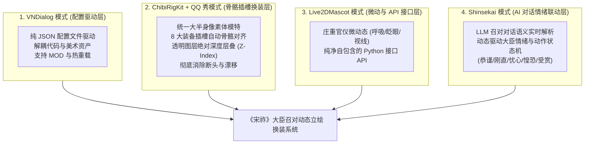
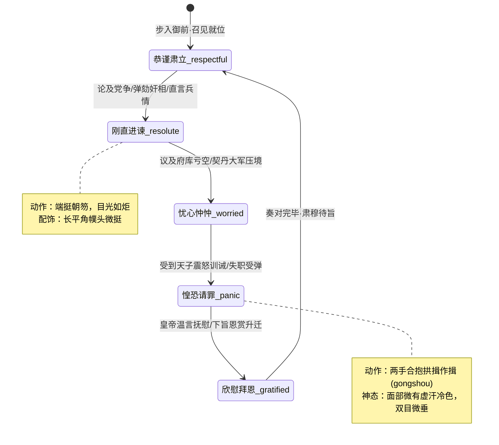

# 《〈宋祚〉大臣召对动态立绘换装系统》技术设计稿（四维融合 + QQ 秀架构）

> **项目定位**：《宋祚》游戏内核心“君臣召对”、“御前奏事”、“除授恩赏”、“廷辩博弈”沉浸式大臣立绘与交互子系统  
> **文档版本**：v3.0.0-PROD (RFC)  
> **权威裁定**：[JEV-台账-四维融合大臣召对动态立绘换装系统设计稿-2026-10-16.json](file:///d:/codebuddy/sz/_dev_tools/handover/decisions/JEV-台账-四维融合大臣召对动态立绘换装系统设计稿-2026-10-16.json)（$p=0.9777$）  
> **状态**：**设计稿待用户终审确认（Sign-off Requested · 确认后方可落地编码）**  

---

## 一、 四大参考项目架构精髓与定位融合（Core Inspirations）

本设计稿系统性融合了用户指出的 **四大开源标杆项目** 与经典的 **“QQ 秀（QQ Show）”** 纸娃娃换装体系：



| 参考项目 | 核心机制借鉴 | 在《宋祚》大臣召对中的具体落地定位 |
|---|---|---|
| **VNDialog** | **轻量级 JSON 配置驱动**（Minecraft Mod） | **数据驱动层**：大臣的初始公服、幞头、面相、朝笏、立绘状态及召对对话分支完全由外部 JSON 描述，代码不硬编码任何具体图片。 |
| **ChibiRigKit + QQ 秀** | **2D 骨骼自动绑定 + 经典 QQ 秀层叠** | **换装结构层**：标准大半身像素体模特（青年/中年/老年），8 大装备槽位纯透明部件物理贴装，衣服自然包裹脖颈，腰带牢固贴合腰线，彻底杜绝断头与浮空黑块。 |
| **Live2DMascot** | **桌面动态立绘与自定义接口**（Python + Live2D） | **官仪微动层**：大臣在召对界面中非死板僵直，具备庄重的大宋官员仪态微动（沉稳呼吸、开合眨眼、须发微颤），并提供优雅统一的 Python 调取接口。 |
| **Shinsekai** | **立绘与 AI 对话的情绪联动**（Python + React） | **交互智能层**：大臣呈递奏折、接受政务廷辩或皇帝训诫时，AI 对话实时触发立绘情绪表情（正色、刚直、忧戚、惶恐）与动作微调（持笏、拱手、抚须、躬身）。 |

---

## 二、 召对立绘展示舞台与数学坐标系（Stage & Geometry）

为杜绝任何“有的半身有的全身、忽大忽小”的比例失调，全系统确立唯一刚性舞台视口：

### 2.1 召对立绘框规格
- **画幅基准**：$810 \times 1080$ 像素（$3:4$ 黄金大半身肖像画幅）；
- **环境底色**：宣和殿御书房老绢本古宣纸底屏（`#C4A877` ～ `#B39562` 柔和径向渐变）；

### 2.2 刚性骨骼锚点树（ChibiRigKit 式骨骼绑定）

```text
 (0,0)┌────────────────────────────────────────────────────────┐
      │  宣和老绢本画心底色 (#C4A877 ~ #B39562)                   │
 y=60 │  幞头山梁顶端 (Futou_Peak) ── 固定顶部留白 5.5% (60px)   │
y=225 │  左右平展长角基线 (Futou_Wings) ── 展角两尺半至一尺半     │
y=285 │  两眼视平线 (Eyes_Line) ── 双眸水平基准线 (绝对恒定)       │
y=395 │  下巴轮廓下沿 (Chin_Base) ── 脸模垂直高度固定 240~260px   │
y=430 │  白色中单交领 (Inner_Collar) ── 护颈素白，紧承脖颈素体    │
y=460 │  双肩线 (Shoulder_Line) ── 宽袍大袖端立 (X: 230..580)   │
y=595 │  双手端持握点 (Hands_Center) ── 握持朝笏下段/合抱作揖     │
y=715 │  公服革带中心 (Waist_Belt) ── 牢固扎系于腰线 (绝不浮空)   │
y=720 │  随身金银鱼袋 (Fish_Pouch) ── 系垂于右腰侧带下至 y=810     │
y=1080└────────────────────────────────────────────────────────┘
      下截截断线：截于革带下方大腿上截垂裾，露出完整双手
```

> **彻底消除断头的几何原理**：
> 1. 素体模特本身拥有从头顶贯穿至下摆的完整胸颈结构；
> 2. 白色中单内领（Layer 4）覆盖在脖颈下部；
> 3. 圆领官袍（Layer 5）圆领开孔正好卡在中单之上；
> 4. 三者层叠后自然严密包裹，**绝无任何切口或背景白洞露出的可能**。

---

## 三、 QQ 秀式 8 大装备插槽与层级架构（Slot & Z-Index Pipeline）

系统按照严格的自底向上（Bottom to Top）Z-Index 渲染树进行装配：

```text
  [Z: 90] 漆纱幞头 (Headwear)   ── 扣压额头发际，平展硬角平直延伸
    ▲
  [Z: 80] 手持朝笏 (Held Hu)     ── 穿插于两手指节之间
    ▲
  [Z: 70] 随身鱼袋 (Fish Pouch)  ── 垂挂于右侧腰带旁
    ▲
  [Z: 60] 公服革带 (Belt)        ── 环扎于大袍腰褶之上 (y=715)
    ▲
  [Z: 50] 官制袍服 (Robe)        ── 披挂于素体肩胸，自然垂落
    ▲
  [Z: 40] 白色中单 (Collar)      ── 交领素白护领，消除脖颈缝隙
    ▲
  [Z: 30] 髯口胡须 (Beard)       ── 贴附于上唇与下巴
    ▲
  [Z: 20] 五官表情 (Face)        ── 贴合于素体头部中心
    ▲
  [Z: 10] 基础素体 (Base Doll)   ── 完整大半身像人体模特 (肤色脖颈/端正仪态)
    ▲
  [Z:  0] 宣和老绢底 (Background) ── 宫廷老绢背屏
```

---

## 四、 VNDialog 模式：纯 JSON 数据驱动配置（Data-Driven Schema）

立绘的所有表现完全由外部 JSON 配置文件驱动，严禁在业务代码中硬编码路径。

### 4.1 大臣召对立绘配置范例（`minister_audience_config.json`）

```json
{
  "$schema": "https://songzuo.online/schemas/minister_portrait_v3.json",
  "minister_id": "ouyang_che",
  "name": "欧阳澈",
  "historical": false,
  "age": 24,
  "base_doll": "doll_young_scholar",
  "current_equipment": {
    "headwear": "futou_short_flat",
    "face": "face_scholar_clear",
    "beard": "beard_none",
    "collar": "collar_white_silk",
    "robe": "robe_green_7th",
    "belt": "belt_black_horn",
    "pouch": "pouch_none",
    "held": "held_wood_tablet"
  },
  "emotion_states": {
    "respectful": {
      "face_variant": "face_scholar_calm",
      "pose": "chihu",
      "eyebrow_angle": 0,
      "mouth_state": "closed",
      "desc": "肃穆持笏，神态恭谨"
    },
    "resolute": {
      "face_variant": "face_scholar_resolute",
      "pose": "chihu",
      "eyebrow_angle": 12,
      "mouth_state": "speaking",
      "desc": "目光刚毅，骨鲠直谏"
    },
    "worried": {
      "face_variant": "face_scholar_worried",
      "pose": "chihu",
      "eyebrow_angle": -8,
      "mouth_state": "closed",
      "desc": "双眉紧锁，深忧边情"
    },
    "panic": {
      "face_variant": "face_scholar_panic",
      "pose": "gongshou",
      "eyebrow_angle": -15,
      "mouth_state": "open",
      "desc": "惶恐自劾，躬身请罪"
    }
  }
}
```

---

## 五、 Shinsekai 模式：AI 对话与立绘情绪/动作联动状态机

在召对界面中，LLM 或剧本生成的对话文本，将自动驱动大臣的立绘情绪与微动作联动：



### 5.1 语义联动触发器实现
```python
def on_dialogue_statement(statement_text: str, current_dna: dict) -> str:
    """根据大臣所言内容或语义标签，触发情绪状态切换。"""
    if any(k in statement_text for k in ("臣死罪", "罪臣", "臣失察", "惶恐")):
        return "panic"
    elif any(k in statement_text for k in ("万不可", "奸相误国", "臣誓不从", "祖宗之法")):
        return "resolute"
    elif any(k in statement_text for k in ("库银见底", "流民四起", "边报紧急", "堪忧")):
        return "worried"
    elif any(k in statement_text for k in ("谢主隆恩", "皇恩浩荡", "臣必当竭力", "微臣拜恩")):
        return "gratified"
    return "respectful"
```

---

## 六、 Live2DMascot 模式：官仪微动态与 Python API 规范

大臣立绘在召对界面中具备端庄的北宋官仪微动（呼吸、眨眼、视线微动），其接口设计极简自包含：

```python
class MinisterAudiencePortraitController:
    """大臣召对动态立绘控制器（对标 Live2DMascot 自定义接口）。"""

    def __init__(self, config_path: str):
        self.load_config(config_path)

    def set_emotion(self, emotion: str) -> None:
        """切换大臣情绪状态 (respectful / resolute / worried / panic / gratified)。"""
        pass

    def equip_item(self, slot: str, item_id: str) -> None:
        """即时换装 (如升官换袍、特赐金鱼袋、赐白玉带)。"""
        pass

    def get_render_frame(self, time_sec: float) -> bytes:
        """获取带有沉稳官仪微动（微弱呼吸起伏、自然眨眼）的当前渲染帧 (PNG/SVG)。"""
        pass
```

---

## 七、 官员晋升换装全生命周期流程（除授即时换装）

以新科进士“欧阳澈”的宦海升迁为例：

1. **初任知县召对（七品公服）**：
   - 模特：青年挺拔素体 (`doll_young`)；
   - 装备：碧绿素罗襕袍 + 短平角幞头 + 乌角铜带 + 质朴槐木手板 + 无鱼袋；
2. **拔擢知州召对（五品朝臣）**：
   - 换装：保持面容骨相，系统自动更新装备插槽：
     `robe -> robe_fei`（朱红绛罗袍）、`futou -> futou_mid`（平展长硬角）、`belt -> belt_silver`（起雀花银带）、`pouch -> pouch_silver`（白银鱼袋）、`held -> hu_ivory`（交趾象牙笏）；
3. **入阁拜相召对（一品宰执）**：
   - 换装：岁月流转，胡须转为三绺美髯，装备升阶：
     `robe -> robe_zi`（深绛紫特织罗袍）、`futou -> futou_long`（两尺半长直铁线角）、`belt -> belt_gold`（透雕荔枝金带）、`pouch -> pouch_gold`（纯金金鱼袋）、`held -> hu_jade_ivory`（老象牙透润玉笏）。

---

## 八、 43 位中枢历史名臣的特殊处理方案

对于蔡京、韩忠彦、曾布、陈瓘、种师道、李纲、宗泽等 43 位拥有真实宋代工笔画像的名臣：
- **方案决策**：
  1. **本职常态**：直接使用归一化的大半身像名画原作（固定取景框视平线 $y=285$），**绝对不拆解切脸**，保真其历史厚重感；
  2. **非凡特赐/被贬流放（如蔡京被贬、李纲拜相）**：
     名臣的头部专属肖像被作为 `Face_Special` 贴片，精准对齐在标准素体骨架上，参与公服（绿袍贬官/紫袍拜相）的 QQ 秀层叠换装。

---

## 九、 待用户确认的核心决策清单（Checklist for Sign-off）

请您审阅以上设计稿，并给予确认拍板：

1. **整体四维融合架构是否认可**：
   是否同意按 **“VNDialog配置驱动 + ChibiRigKit/QQ秀骨骼插槽 + Live2DMascot官仪微动接口 + Shinsekai对话情绪联动”** 的综合架构推进？
2. **召对大半身像（$810 \times 1080$）统一取景框是否定型**：
   视平线 $y=285$、腰线 $y=715$、幞头留白 $5.5\%$、下边缘截断于腰下垂裾大腿上截。
3. **确认后下一步的启动顺序**：
   - 第一步：落地 `minister_audience_config.json` 架构与素体骨骼锚点系统；
   - 第二步：准备 3 套年龄模特素体与绿/绯/紫核心公服透明装备资产；
   - 第三步：实现召对对话情绪联动状态机。

**在您确认拍板本设计稿之前，我不会擅自修改或提交任何业务代码。期待您的指示！**
