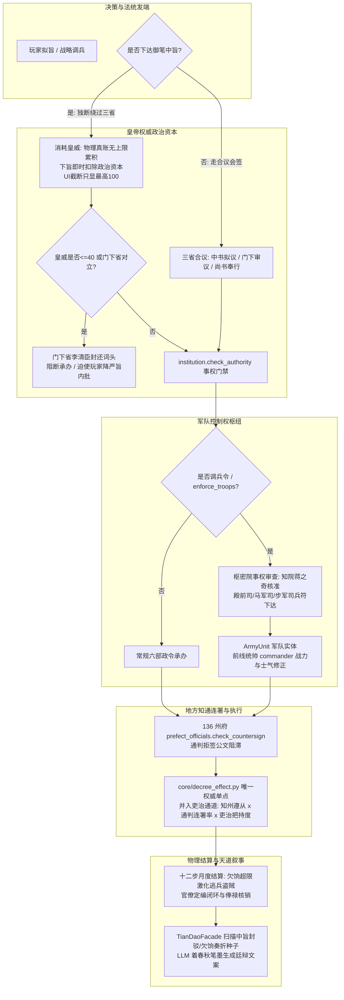

# 官制事权门禁、皇威政治资本与军队控制权深度耦合实施方案

> **版本**：v1.0 (2026-10-17)  
> **单一权威目标**：中枢事权法统门禁闭环、皇威物理无限积累与UI脱敏截断、枢密调兵与统帅实效、知通互掣向诏书执行率咬合。  
> **既有口径守卫**：诏令实际效果全库唯一单点为 `core/decree_effect.py`（吏治、民心、军队三通道严禁新增）；POP 挂载律全守恒；不设平行账本。

---

## 一、架构设计理念与总览

在北宋，“虚君制与士大夫共治”、“枢密调兵与三衙管军分离”、“知通公事连署”构成了赵宋祖宗家法的三大支柱。
本方案将**官职权限、皇帝权威与军队控制权**深度缝合进游戏既有的五大底层（POP真账、国库/内帑双轨仓、十二步月推演流水线、诏令生命周期与天道双层智能）。

---

## 二、皇帝权威（Prestige）重构规格

### 2.1 物理真账无上限积累，UI 与脱敏展示截断至 100
- **物理真账原则（用户 2026-10-17 裁定）**：
  - 核心属性 `state.prestige` 积累**无上限**（取消原 `PRESTIGE_MAX = 100` 的物理顶死截断）；
  - 开疆拓土、万国来朝、盛世治绩可使皇威突破 100，蓄积为坚不可摧的帝王法统资本；
  - 下限守卫：维持 `PRESTIGE_MIN = 0`。
- **UI 与对外展示层截断**：
  - 前端面板、HUD 与对外读取接口统一使用 `min(100, state.prestige)`；
  - 读数脱敏函数 `desensitize_prestige(val)` 超过 100 统一返回「鼎盛」，保证玩家界面统一感知，但在底层保留超额皇威蓄水池。

### 2.2 御笔中旨消耗政治资本与门下封驳
- **中旨扣减机制**：
  - 诏令声明 `is_zhongzhi: True` 时，下发瞬间即时扣除皇威 `4` 点（调兵中旨扣 `6` 点）；
- **门下省封还词头（封驳）门禁**：
  - 若当前有效皇威 $\le 40$（处于“不振”或“扫地”档位），或门下侍郎（李清臣）派系对立且清廉度 $\ge 0.6$：
    1. 门下省触发封还词头，阻断执行，返回 `status="unauthorized"` 与原因 `“门下省封还御笔中旨，言不合祖宗法度”`；
    2. 玩家可选“降严旨内批强推”：再次透支扣除 `6` 点皇威强制通关，但激化台谏辞官潮与民怨。

---

## 三、中枢事权法统门禁完善

### 3.1 游离编制参数的事权闭环（法统防漏）
在 `content/data_constants.py` 的 `INSTITUTION_PARAM_SPEC` 中，为所有游离参数补齐 `authority` 约束：

| 参数 Key | 现有状态 | 补齐后事权（`authority`） | 承办机构与责任官职 |
|---|---|---|---|
| `posts_quota_mult`（定编宽严） | 无约束（任何主体可改） | `"官吏铨选"` | **吏部**（吏部尚书） |
| `yinben_mult`（恩荫之门） | 无约束 | `"官吏铨选"` | **吏部**（吏部尚书） |
| `rank_up_mult`（磨勘年限） | 无约束 | `"官员考课"` | **吏部**（吏部尚书） |
| `retire_mult`（考课黜落） | 无约束 | `"官员考课"` | **吏部**（吏部尚书） |
| `clerk_pay_mult`（吏禄薪基） | 无约束 | `"度支调度"` | **户部**（户部尚书） |
| `asset_maintain_mult`（资产维持费） | 无约束 | `"度支调度"` | **户部**（户部尚书） |
| `metrology_system_id`（度量衡体制） | 已完成（M324） | `"度量衡"` | **工部**（工部尚书） |
| `didang_*`（抵当所金融旋钮） | 已完成 | `"官营放贷"` | **户部**（抵当所提举） |

---

## 四、军队控制权与调兵统兵分离

### 4.1 调兵权（枢密院）与统兵权（三衙）的分离校验
- **民政调兵（`enforce_troops`）审查**：
  - 当诏令使用 `enforce_troops=True` 时，必须由掌 `"调兵"` 事权的执行主体（**枢密院**）签发；
  - 若未指定主体或指定非掌兵部门，一律由 `institution.check_authority` 驳回；
- **边防与禁军调配**：
  - 调兵出塞必须经过知枢密院事蒋之奇核发宣敕，下达殿前司高俅等三衙统兵官奉行。

### 4.2 前线统帅（`ArmyUnit.commander`）战力与士气实效
将 `commander` 字段从纯展示层激活为战斗力与月度战备士气影响源：
1. **月度战备士气修正**（挂载于 `settlement_military.py`）：
   $$\Delta \text{morale} = \text{round}\left( (\text{commander.ability} - 0.5) \times 4 - (\text{commander.corruption}) \times 3 \right)$$
   名将挂帅稳步提升士气，庸将贪官在任克扣军饷压低士气；
2. **战力判定（`army_power`）修正**：
   统帅之「军略」、「宿将」特质使部队在战场判定中获得 $+15\%$ 的效能加成。

### 4.3 欠饷累加与流寇盗贼激化
- 军队欠饷真账：沿用 `ArmyUnit.arrears`；
- **惩罚阈值（挂载于 Step 6 军事结算）**：
  - 若 `u.arrears >= 3 个月饷额`：部队月度士气强制额外扣减 $3$ 点；
  - 若 `u.arrears >= 6 个月饷额`：触发“溃卒啸聚”，该路每月有 $1000$ 名士兵逃亡（转入流民并提升地方动荡度），直至朝廷发内帑或拨国库补齐欠饷。

---

## 五、知通互掣直接咬合中央圣旨执行率

在 [`game/core/decree_effect.py`](file:///d:/codebuddy/sz/game/core/decree_effect.py) 的 `calc_decree_execution_rate` 中：
- 严格保留定稿口径（吏治为唯一强关联通道，不新增通道）；
- 地方遵从度（`circuit_compliance`）平滑注入通判连署率：
  $$\text{地方遵从有效值} = \text{circuit\_compliance} \times (0.35 + 0.65 \times \text{seat\_countersign\_ratio})$$
- 通判拒不连署公文（`countersigned == False`），则地方行政公文阻滞，直接拉低吏治通道表现。

---

## 六、实施路线图与验收断言表

| 阶段 | 任务目标 | 核心改动模块 | 验收断言与测试文件 |
|---|---|---|---|
| **Phase 1** | 皇威物理无上限积累 + UI截断100 + 中旨扣除皇威与门下封驳 | `game/core/game_state.py` `game/content/data_constants.py` `game/core/decree_confirm.py` | `tests/test_prestige_and_zhongzhi_gate.py` - 断言皇威累加至 150 不被截断； - 断言对外 `get_prestige_info` 截断为 100； - 断言中旨扣皇威，皇威 $\le 40$ 触发门下封驳阻断。 |
| **Phase 2** | 游离编制参数事权门禁补齐（吏部/户部） | `game/content/data_constants.py` `game/core/domains/administration/institution.py` | `tests/test_institution_authority_closure.py` - 断言改定编非吏部拒绝； - 断言改吏薪非户部拒绝。 |
| **Phase 3** | 调兵事权门禁审查 + 知通互掣深度咬合 `decree_effect` | `game/core/decree_effect.py` `game/core/decree_confirm.py` | `tests/test_military_authority_and_countersign.py` - 断言 `enforce_troops` 必须由枢密院承办； - 断言通判拒签使吏治通道折损。 |
| **Phase 4** | 统帅战力实效 + 欠饷激化逃兵与士气衰减 | `game/core/domains/military/army_models.py` `game/core/settlement_military.py` | `tests/test_commander_power_and_arrears_unrest.py` - 断言良将提升士气，贪官压低士气； - 断言欠饷超 6 个月触发逃亡减员。 |
