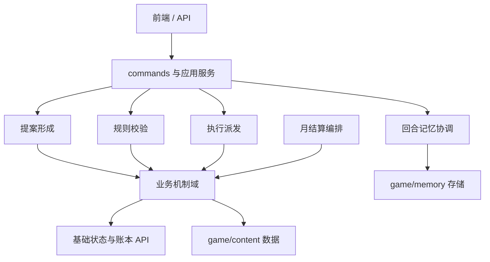

# 代码层机制模块化架构方案

> 日期：2026-10-06  
> 状态：**分阶段实施中**（阶段 1 已完成、阶段 2 进行中——§8 的「一批一包」为硬纪律）；  
> 本文件仍是目标架构，**不代表某模块已迁移**——逐包实测状态唯一权威 = `game/core/foundation/README.md`。  
> 目的：把 `game/core/` 从按历史拆分文件平铺的形态，逐步整理为按游戏职能组织的模块，降低维护成本，让新机制有明确归属。  
> 设计原则：按**流程职责、业务机制和共享基础能力**划分代码。模块数量由实际机制边界决定，不预设固定数量，也不映射为游戏内官制。

## 1. 结论摘要

建议把架构分成四类责任模块：

1. **基础与账本层**：游戏状态、POP/钱粮/商品等唯一真账、桥接与存档。
2. **流程编排层**：提案形成、规则校验、执行派发与跨机制协调。
3. **业务机制层**：按人口、财政、官制、生产、建设、外交等实际规则边界拆分；模块可继续细分或合并。
4. **接口适配层**：现有命令入口、结算入口、Backend/API 和 UI 读数保持薄适配。

记忆存储本身已有 `game/memory/`；需要从 `commands.py` 抽出的，是**回合生命周期对记忆的协调流程**，不是再造一套记忆账本。

目标代码树：

```text
game/
├── core/                         # 对外兼容入口与核心规则包
│   ├── foundation/               # 状态、唯一账本、桥接、存档、通用数值/错误
│   ├── workflows/                # 跨机制流程：提案、校验、执行、回合生命周期
│   ├── domains/                  # 业务机制包，按实际规则边界拆分，可继续细分
│   │   ├── population/            # POP、户籍、人口结构与人口读数
│   │   ├── economy/               # 财政、粮政、税务、市场与商品流转
│   │   ├── administration/        # 官员、吏员、机构与任免
│   │   ├── production/            # 农业、岗位、配方、生产链
│   │   ├── construction/          # 建筑、工程、蓝图与长期营造
│   │   ├── transport/             # 州府交通、物流、在途批次
│   │   ├── diplomacy/             # 外交协议、外邦交互
│   │   ├── politics/              # 派系、局势、事件等跨机制政治状态
│   │   └── culture/               # 教化、科举、识字等文化机制
│   ├── settlement/               # 月结算总流程与步骤顺序
│   └── compatibility/            # 迁移期旧模块名/旧导入路径兼容层
├── application/
│   └── turn_lifecycle.py          # 回合收尾、记忆任务协调等应用流程
└── memory/                       # 已有记忆图谱与对话记忆存储/查询
```

`core/` 当前作为 Python 导入根（调用方大量使用 `from core...`）。初期保留现有对外入口，内部按阶段改为新包路径；不在一次提交里全仓改名。

> **实施注记（2026-10-07）**：兼容路线已由阶段 2 实践定为**旧路径薄转发桩**
> （`core/<模块>.py` 原地转发、dir() 显式枚举、不复制实现），**不是**集中式
> `compatibility/` 包——该目录保留为预留位。逐包状态唯一权威 = `game/core/foundation/README.md`。

## 2. 流程编排模块

流程模块负责一个玩家意图或 AI 建议从形成到执行的过程，业务机制域负责实际规则。按职责拆分，不把所有流程挤进一个超大命令文件，也不让流程层复制业务规则。

| 代码域 | 责任 | 典型现有职责 | 不负责 |
|---|---|---|---|
| **提案流程** | 形成政策/诏令/事务草案；把玩家意图或 AI 建议转成结构化提案 | `commands_decree` 拟诏/草拟路径、`decree_plan`、部分 `longterm_task` 计划表达 | 不直接绕过规则层改 POP、国库或库存；AI 不直接计算并落地结算数值 |
| **校验流程** | 校验提案是否完整、合法、可执行；处理确认、复核和拒绝 | `decree_confirm`、契约校验、权限与前置条件检查、机密知情边界 | 不拥有业务计算，不以叙事文本代替执行结果 |
| **执行流程** | 接受通过校验的命令，派发到业务机制；协调跨机制用例 | `commands` 动作入口、`plan_commit`、执行器路由 | 不复制业务规则，不拥有第二份库存或状态 |

**流程约束**：提案 → 校验/确认 → 执行 → 结果回报。简单命令可跳过不适用的步骤，但必须有显式路径；命令入口不得私自复制业务规则。

## 3. 业务机制模块

每条业务规则要有明确的**唯一维护归属**。以下是按当前代码盘点得到的候选机制域，不是固定清单；后续可按耦合度继续拆分、合并或新增。若某项玩法当前不存在，只标作候选扩展，不得写成“已实现”。

| 机制域 | 目标包 | 业务所有权与现有代码候选 | 边界说明 |
|---|---|---|---|
| **人口与户籍** | `domains/population/` | POP、户籍、人口结构与人口读数；候选 `pop_structure.py`、`population_readout.py` 及相关人口规则 | POP 真账仍在基础账本层；该域通过桥接 API 改变人口，不复制 POP 账本 |
| **财政与市场** | `domains/economy/` | 财政、税务、粮政、市场、价格、需求和商品流转；候选 `settlement_finance.py`、`settlement_granary.py`、`settlement_econ.py`、`market*.py`、`demand.py` | 货币、粮、商品唯一真账归基础层；付款、运输、库存持有各有明确服务边界 |
| **行政与官制** | `domains/administration/` | 官员履历、任免、官僚/吏员编制、机构规则；候选 `officialdom.py`、`clerks.py`、`minister_profile.py`、`institution.py` | 大臣 Agent 的表达/决策适配不等于官制规则；具体迁移前按调用关系拆分 |
| **生产机制** | `domains/production/` | 农业、岗位、配方、供给链与商品产出；候选 `building_jobs.py`、`production_chain.py`、农业相关规则 | 投料、货主、产出和登记状态按各自口径处理；不能绕过库存/产权规则 |
| **建设机制** | `domains/construction/` | 建筑、蓝图、建设成本、民间营造和工程效果；候选 `construction*.py`、`civil_building.py`、`longterm_task.py` 中工程职责 | 工程资金走真实资金通道，材料通过持有者/市场/运输服务；不拥有平行国库或物料仓 |
| **交通与物流** | `domains/transport/` | 州府交通可达、运输耗时、在途批次；候选 `transport.py`、物流相关读数 | 运输本身不创造商品或完成交易；与市场/库存通过显式接口协作 |
| **外交与外事** | `domains/diplomacy/` | 外交协议、外邦交互和外事读数；候选 `diplomacy_treaty.py`、`external_view.py` | 按规则所有权拆分，不按“外邦”关键词整体搬文件 |
| **政治与世界状态** | `domains/politics/` | 派系、局势、事件及跨机制政治状态；候选 `faction_*.py`、`situation_*.py`、`events.py` | 属横切机制，提供稳定读写接口，不接管各域结算规则 |
| **军事机制** | `domains/military/` | 军队模型、募兵裁军、军令与军事结算；候选 `army_models.py`、`settlement_military.py`、军事命令 | 军队人数变化通过 POP 专用通道；军饷/粮械使用既有账户，不复制账本 |
| **司法机制** | `domains/justice/` | 司法、调查、惩处与执行反馈；现有 decree/事件/制裁逻辑需逐项盘点 | 不预设现有代码已形成完整司法系统；缺少功能标作待建，不造空模块或伪实现 |
| **教育与礼仪** | `domains/culture/` | 科举、教化、识字率、礼仪等规则；候选 `literacy.py` 与相关机制 | 只纳入实际存在的规则；与行政、外交、事件通过接口协作 |

> **归属实况脚注（2026-10-07）**：候选列仅是提案视角——**实际归属以
> `甲批_符号归属与新旧路径表.md` + `foundation/README.md` 为准**。已定案差异：
> `pop_structure` 落 `foundation/ledger/`（判据：其主体是 POP 守恒写入通道——
> `move_pop_people`/农 slices 同步——而非业务读数；人口域届时经接口调用账本层）。

### 3.1 横切能力单独归位

- **政治与世界状态**：`faction_*`、`situation_*`、`events.py` 属跨机制能力，作为独立域通过明确接口协作，不归某一业务域独占。
- **游戏状态与账本**：`GameState`、`pop_bridge`、`grain_bridge`、`material_holding` 中的唯一账本访问职责、`save_load` 属基础能力；业务规则归部，权威数据载体不分裂。
- **记忆**：`game/memory/` 是记忆数据存取域；记忆何时压缩、总结、落盘属于应用生命周期协调。
- **读数**：UI/API/AI 所需查询是只读投影，不另建可变业务状态；可按业务域放在 `read_models/` 子包或各部 `readout/`，不能反向成为结算算法权威。
- **静态内容与注册表**：`game/content/` 持有玩法内容数据；核心业务包可依赖内容表，内容层不得反向导入核心结算实现。

## 4. 基础层与账本边界

### 4.1 基础层职责

`foundation/` 提供底层状态结构、账户/实体定位、守恒写入通道、存档兼容和通用错误/数值工具。它是业务域可依赖的低层，不是堆放“暂时不知道放哪”的通用目录。

按语义进一步分包：

```text
foundation/
├── state/          GameState、初始状态构建与状态字段注册
├── ledger/         POP/钱粮/物料权威账户与读写 API
├── persistence/    存档读写、版本迁移
└── common/         numeric、errors 等真正跨域且无业务归属的基础工具
```

`pop_bridge` 等迁移桥在逐步收敛期间可留在 `ledger/`；完成后仍保留守恒断言、迁移兼容职责，而非让业务部直接写底层结构。

### 4.2 必须保持的项目不变量

- POP 真账继续在治所级；路级 POP 是只读派生聚合。模块迁移不能改变挂载位置或下沉/聚合语义。
- 钱、粮、商品保持单一权威载体；读数是派生结果，不创造第二本账。
- 缺失、零、默认系数保持可区分；迁移不能借重构补造默认值。
- 存档升级只能显式、幂等地迁移；旧模块兼容入口不得覆写已经下沉的真账。
- 结算顺序是玩法规则。步骤移动必须说明前后依赖，且由一个唯一编排器声明。

## 5. 回合记忆回写：已有存储，抽离协调

### 5.1 当前事实

- `game/memory/memory_graph.py` 与 `game/memory/dialogue_memory.py` 已提供记忆图谱/对话记忆能力。
- `commands.py::finish_turn` 当前承担终局判定、记忆压缩/总结/落盘、对话记忆周期总结等多个生命周期动作；其他命令路径也直接调用记忆库 API。
- 因此目标不是再造 `memory` 存储，而是把“回合收尾该触发哪些记忆动作、失败如何处理、何时持久化”从命令入口抽到应用服务。

### 5.2 目标接口

```text
application/turn_lifecycle.py
    finish_turn(state)
      ├── check_terminal_state(state)          → evaluation
      ├── memory_lifecycle.on_turn_finished(state)
      │     ├── summarize_dialogue_if_due(state)
      │     ├── compress_memory_if_needed(state)
      │     └── persist_memory(state)           → game/memory adapters
      └── return lifecycle result
```

规则：`commands.finish_turn` 迁移期保留同名薄代理；记忆生命周期模块不运行月结算，不复制 `state.memory` 数据，不吞掉持久化错误（沿用现有“记日志、不阻断主流程”的明确失败语义），且可单测每种触发条件和失败路径。命令/政令执行中的记忆写入按用例逐步委托，不在第一次拆分时全仓重写。

## 6. 依赖方向与接口规则



硬规则：

1. **向下依赖**：API/前端 → 应用流程 → 流程编排/结算编排 → 业务机制 → 基础账本/内容数据。下层不得反向导入上层。
2. **机制间协作经接口**：不得跨域读写私有内部函数或私有数据结构。常用协作能力提升为显式服务/协议；跨域流程放应用编排，不由某个业务域暗中兼管。
3. **结算步骤归属业务域，顺序归编排器**：具体业务步骤由规则所属机制实现，`settlement` 负责唯一顺序，不在业务域内另开一套月结算。
4. **基础状态避免导入业务包**：`GameState` 不能顶层导入业务机制模块；状态扩展采用字段定义/工厂注册或函数内延迟装配，防循环依赖。
5. **禁止通用垃圾桶**：`common.py` 仅保留真正无领域语义的共享工具；某部专用 helper 留在该部。
6. **公共接口小而稳**：包 `__init__.py` 只暴露稳定服务/类型，不通配 re-export 整个旧模块。

> **规则 2 已知偏离登记（2026-10-07，阶段 4 前销账）**：
> `domains/economy/material_trade_ops.py` 暂用 ledger 私有符号
> `_attribute_to_seats` / `_route_of`（丙批二为守「一批一包」未顺手接口化）。
> 销账动作=把它们提升为 ledger 显式接口；追踪于两份 README（foundation §三 / economy）。

## 7. 从现有平铺文件到目标包的迁移映射

下表是**候选归属**，迁移前须以符号调用图和副作用盘点为准；一个文件中混有多个领域职责时先拆职责、后移动文件。

| 现有文件群 | 目标责任域（候选） | 注意事项 |
|---|---|---|
| `game_state.py`、`game_state_econ.py` | `foundation/state/` + 经济查询服务 | `GameState` 被广泛导入，不能一次拆类；先隔离字段/创建逻辑，再移动纯函数 |
| `save_load.py`、`save_load_util.py` | `foundation/persistence/` | 保持旧存档迁移幂等，兼容旧导入路径 |
| `pop_bridge.py`、`pop_structure.py`、`grain_bridge.py`、`grain_ledger.py` | `foundation/ledger/` | 桥接语义、州府真账、守恒断言先稳定；不得形成双写 |
| `settlement*.py` | 按业务内容迁入各部；编排保留 `settlement/` | 当前共用 helper 与跨域调用需拆分；不把 13 个文件原样整体塞进一个 `settlement` 包 |
| `commands.py`、`commands_decree.py` | `workflows/` + `application/` + 兼容门面 | 按用例流程拆分；保持 backend/client 动作名和外部函数兼容 |
| `officialdom.py`、`clerks.py`、`minister_*.py`、`institution.py` | `domains/administration/` 候选 | AI Agent/画像与任免制度分离，避免官制包承担 AI 基建 |
| `market*.py`、`demand.py`、`material_market.py`、`material_trade.py`、农业/财政/粮政文件 | `domains/economy/`、`domains/production/` 候选 | 资金/货物支付、运输、库存持有的责任边界不可因搬文件而合并 |
| `construction*.py`、`civil_building.py`、`building_jobs.py`、`production_chain.py`、`transport.py` | `domains/construction/`、`domains/production/`、`domains/transport/` 候选 | 生产、工程、交通各自按机制边界归位；市场成交仍由经济域 API 提供 |
| `army_models.py`、`settlement_military.py`、军事命令 | `domains/military/` 候选 | 兵额与 POP、军需与库存的跨域通道保留 |
| `diplomacy_treaty.py`、`external_view.py`、礼仪/科举/文化规则 | `domains/diplomacy/`、`domains/culture/` 候选 | 外交协议、交易规则、外部势力数据分别判责，不按文件名打包 |
| `faction_*.py`、`situation_*.py`、`events.py` | 独立政治/世界状态域 | 跨部门能力，需明确其公共读写接口 |
| `evaluation.py`、`numeric.py`、`errors.py`、`registries.py` | 基础或应用支持域（逐项定） | `registries.py` 可能混合业务注册表，须先审内容，不整体视为通用 |
| `memory_graph.py`、`dialogue_memory.py` | 继续归 `game/memory/` | 存储已独立；只迁移回合生命周期协调代码 |

## 8. 迁移策略：逐包搬迁，接口先行

> 各阶段实施状态一览（**不写数字/清单，只给指针，防第二台账漂移**）：
> 阶段 0 ✅ · 阶段 1 ✅（产出与「循环=0」更正见 `阶段1_依赖图与循环依赖.md`）·
> 阶段 2 🔵 进行中，**位置=早期**（逐包状态与完成度分母 → `game/core/foundation/README.md` §〇）·
> 阶段 3 ⬜ 未开始（前置=12 条反向边**接口倒置**）。
> **2026-10-07 实测校正前置条件**：这 12 条**已全部是函数内延迟 import（顶层 0 条）**，
> 且依赖图扫描口径（`ast.walk`）本就计入它们 ⇒ 阶段 3 欠的是**接口倒置**，不是延迟化；
> `game_state → settlement_imperial` 那条 🔴 的判据（"须函数内延迟装配"）实际已满足，撤下。
> 详见 `阶段1_依赖图与循环依赖.md` §五（含逐条行号与该现场的异常吞噬统计）。
> 阶段 4 ⬜ 未开始（含"把已迁模块的旧路径引用分批改指新路径"——**这项还没开始**，
> 所以"生产调用已接入新路径"目前为 0；不得因阶段 2 已交付出账本层而误读为已切换）。
>
> **阶段 2 的"做完"判据（本表刻意不记数字，只锁判据，避免第二台账）**：
> ① 目标包内存在实现；② 旧入口收敛为转发桩且 `dir()` 公开面不变；
> ③ 定向回归（符号同一性 + 非空哨兵）通过；④ **外部调用方引用改指新路径**。
> 当前 ①②③ 对 8 个已迁模块成立，**④ 全部未做** ⇒ 阶段 2 处于早期。

### 阶段 0：架构基线与文件认领

- 维护本架构图、现有模块清单、公开符号与主要调用者清单。
- 对每个目标包补充 `README.md`：拥有的规则、真账/派生读数、公开接口、禁止依赖和当前迁移状态。
- 结合 MCP `tasks` 认领具体包/文件；共享文件改前遵守项目 §1 声明协议。

### 阶段 1：稳定入口与依赖图

- 先建立目标包骨架、`__init__.py` 和接口协议，暂不移动实现。
- 记录 `core.commands`、`core.settlement`、`core.game_state` 等外部兼容入口。
- 自动扫描 import 图和循环依赖；明确每一条既存反向边的替代接口。

### 阶段 2：低耦合叶子模块先迁

- 优先迁移无状态/纯计算、调用面小的读数或通用算法。
- 新路径成为唯一实现位置，旧文件只做显式转发，不复制函数体。
- 每一小批只迁一个业务包；当轮只处理一个职责域。

### 阶段 3：高耦合服务和结算域

- 先从 `commands.py` 抽出回合生命周期协调，再拆命令用例。
- 逐步把 `settlement_*` 函数归属到业务部，保留唯一结算编排器与原步骤顺序。
- 按 POP、粮、财富、goods、身份子池等通道分别扫描读写点；不能只靠文件移动或 grep 判断完成。

### 阶段 4：旧入口退役

- 对所有仓库内调用迁到新路径；第三方/测试仍使用旧路径时保留兼容门面。
- 只有全仓无内部旧路径引用、兼容覆盖明确、存档往返与全链验证通过后，才讨论移除旧入口。
- 模块迁移是纯结构变更时也须验证 import、行为快照和序列化兼容；若同批顺带改规则则拆开提交。

## 9. 验收标准

每个迁移批次必须同时满足：

1. 新旧公开入口指向同一实现，没有复制算法或双重状态。
2. 模块依赖符合第 6 节；没有新增循环导入；启动、API 命令和测试 import 正常。
3. 既有结算步序、存档 schema、POP/钱粮/商品守恒口径不变；若必须变化，另开规则变更批次并先写规格。
4. 定向回归覆盖迁移符号和跨域协作；核心逻辑改动时遵守 `AGENTS.md` 的放行门，并**串行**跑放行门与全量测试，不并发争抢内存。
5. 各部 README、`game/core/README.md`、相关机制文档同步记录真实迁移状态；“代码在新目录”不等于生产调用已经接入。

## 10. 明确不做

- 不把代码模块边界写成游戏内机构或玩法事实，也不为匹配某种组织数量强造模块。
- 不把 92 个平铺文件一次性批量搬迁或统一重命名。
- 不以目录树改完、测试文件存在或兼容导入成功单独宣称模块化完成。
- 不以大规模机械 import 替换代替依赖边界设计。
- 不把所有共享逻辑塞入 `common.py`、`utils.py` 或单个总控模块。
- 不把 `memory` 当作 POP、财政、库存之外的新账本；记忆只保存游戏叙事/决策所需状态，不成为模拟规则真账的替代物。

## 11. 评审后待确认（2026-10-07 状态收口）

1. 是否接受“基础能力 + 流程编排 + 业务机制 + 接口适配”的责任分层。——✅ **已裁定接受**（阶段 2 五批~丙批两批均按此分层推进并逐批放行，2026-10-06/07）。
2. 哪些机制域还需要细分，哪些可合并为一个维护边界。——⬜ 仍开放（现仅 ledger/economy 有实现，判据积累中）。
3. 财政与建设、外交与贸易等跨域规则，按“规则所有者 + 被调用服务”细化到符号级。——🔵 部分落地：`material_holding` 已按甲批表到符号级；其余待各域开迁时做。
4. 迁移期兼容入口保留多久，以及是否把 `core/` 中兼容门面列为稳定公共 API。——⬜ **仍悬空，已登记云端 `decisions` 键**（协议：决策进 decisions，不写 phase）。
